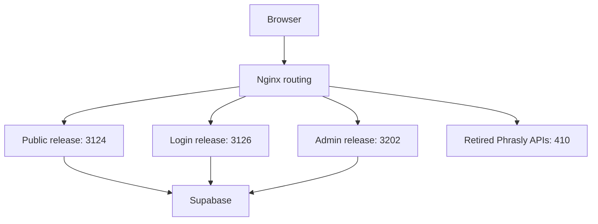

# Phrasly Phase 1: baseline and remaining gate

Status on 25 October 2026: **source baseline and isolated compilation verified; VPS backup/restore verification blocked by the offline SSH bridge**. Phase 1 is not complete. No production release was deployed, service restarted/reloaded, or database mutation issued.

## Source and Git baseline

Dedicated branch: `phrasly/phase1-baseline-20261025`.

Base: `663f59675300183fa738f7f5eb43841f536d2bb9` from `turnitin/phase4-phase5-admin-20261024`. Main remains at `28c9e1d1058b73be11056af94522b2758fe66de8`. Both original branch refs were rechecked unchanged.

[Source provenance](phase1-source-baseline.md) records eight exact deployed files preserved in commit `f3dbde3fab0994f999e9e2a0e464128dba79075f`. All eight files plus the provenance document were read back through GitHub and matched. They preserve existing functionality before Phrasly changes; no new Phrasly processing is enabled.

## Live deployment map

TopRatedSEOTools.com uses React, TanStack Start, Nitro, Node and Supabase on its existing VPS. The AWS PHP implementation remains a separate reference.

| Request | Current upstream | Release |
| --- | --- | --- |
| Default public site, including Phrasly product page | Loopback 3124 | `/home/ubuntu/releases/trst-phase3-schema-20261015` |
| Exact `/login` and three pinned login asset routes | Loopback 3126 | `/home/ubuntu/releases/trst-authfix-20261015` |
| `/admin` and `/admin/` | Loopback 3202 | `/home/ubuntu/releases/trst-admin-phase5b-payments-20261024` |
| Shared `/assets/` | Nginx static files | `/var/www/trst-assets-unified-20261015` |
| Robots and sitemap | Nginx static files | `/var/www/trst-seo-static` |
| `/api/phrasly-proxy*` and `/api/diag/phrasly-*` | Nginx return | HTTP 410 |

The `/ng` and `/gh` routes retain a separate upstream. Existing ChatGPT and StealthWriter services are outside this change.



The public release is bundle-only on the VPS. Login has a separate older source snapshot. This branch corresponds to admin source, whose server functions use `/admin/_serverFn`. A successful branch build is not proof that it can replace all three releases. Preserve their routing and compiled runtimes separately.

Node `22.23.2`, npm `10.9.8`, Git `2.43.0` and Nginx syntax were verified through SSH. All five observed PM2 processes were online with zero recorded restarts at initial inventory. The original VPS Git checkout was older and dirty; it was not reset, checked out or cleaned.

## Verified checks

| Check | Result | Evidence |
| --- | --- | --- |
| Admin source comparison | PASS | 376 matching build files, 3 changed, 5 extra, 0 missing |
| Eight recovered source files reviewed | PASS for snapshot scope | No private keys, server secrets, provider credentials or customer records |
| GitHub readback | PASS | All eight files and provenance matched |
| Clean npm installation | FAIL, baseline limitation | Existing package-lock.json is stale; no dependencies changed |
| Frozen Bun install | PASS | Existing bun.lock matches package.json |
| Isolated compile and runtime/browser artifact checks | PASS | [Run 40192768445](https://github.com/Osuagwu101/topratedseotools-0bc24c5f/actions/runs/40192768445), commit `0930385f42593d9274858e66356c34986a3378e8` |
| Backup helper fixture tests | PASS, 7/7 | Intact fixture accepted; truncation, content/link changes, incomplete metadata, public permissions and path traversal rejected |
| Public endpoint checks | PASS, 6/6 | Rechecked 2026-10-25T12:25:48Z |
| Phrasly database counts | PASS, unchanged | Read-only settings/session counts zero before and after |
| Actual host-local backup and restore rehearsal | UNVERIFIED | Backup driver started; completion unavailable after SSH bridge went offline |
| Final host file hashes and process comparison | BLOCKED | Requires the SSH bridge |

The npm failure is [run 40192659061](https://github.com/Osuagwu101/topratedseotools-0bc24c5f/actions/runs/40192659061). Its log reports an outdated Lovable Vite config version and missing dependencies in package-lock.json. The corrected workflow uses the existing Bun lock, pinning Bun `1.4.4` and Node `22.23.2`. Neither lockfile nor production dependencies changed.

`/`, `/login`, `/tools/phrasly` and `/admin/turnitin-billing` returned 200. The proxy and bootstrap endpoints returned 410. Admin HTTP 200 establishes availability only, not authenticated behavior.

Read-only Supabase Phrasly settings, stored authorized sessions and proxy session counts were zero at 12:02:33 UTC and 12:19:10 UTC. No customer/payment rows or credentials were exported. Login and provider processing were not tested in Phase 1.

## Reproduce compilation

Use a new checkout and disposable build directory. The [branch-only workflow](../../.github/workflows/phrasly-phase1-baseline.yml) removes root environment files inside its disposable runner and runs:

```sh
bun install --frozen-lockfile --ignore-scripts
npm run build
```

It uses dummy configuration and checks the generated Node entry, browser JS and CSS. It starts no server and contains no deployment step. This establishes compilation, not authentication or end-to-end provider operation.

| Variable | Compile check | Later staging/production |
| --- | --- | --- |
| `SUPABASE_URL` | Loopback dummy URL | Approved project URL |
| `SUPABASE_PUBLISHABLE_KEY` | Dummy | Public browser-compatible key |
| `SUPABASE_SERVICE_ROLE_KEY` | Dummy | Server-only secret, never a Vite variable |
| `VITE_SUPABASE_URL` | Loopback dummy URL | Approved public URL |
| `VITE_SUPABASE_PUBLISHABLE_KEY` | Dummy | Public key only |
| `VITE_SUPABASE_PROJECT_ID` | Dummy | Approved staging project reference |
| Provider credentials | Absent | Authorization/integration decision belongs to Phase 2 |

The existing production-hostname client pin is preserved. Dummy configuration makes non-production compilation independent of live credentials; it does not remove that pin or authorize provider access.

## Remaining gate

Follow [backup and rollback procedure](phase1-rollback.md). Inspect the already-started operation before repeating it. Mark backup success only after checksums, isolated extraction, file/link/mode comparisons and runtime dependency checks pass. Recheck live source/configuration hashes, process identity/restart counts and HTTP results.

Remote Commander stopped receiving responses from the authorized Windows SSH bridge and later reported no online device. This is a transport blocker, not evidence of an invalid SSH key. Complete the backup gate before integration implementation. Provider cookies, sessions and access-control workarounds are excluded.
