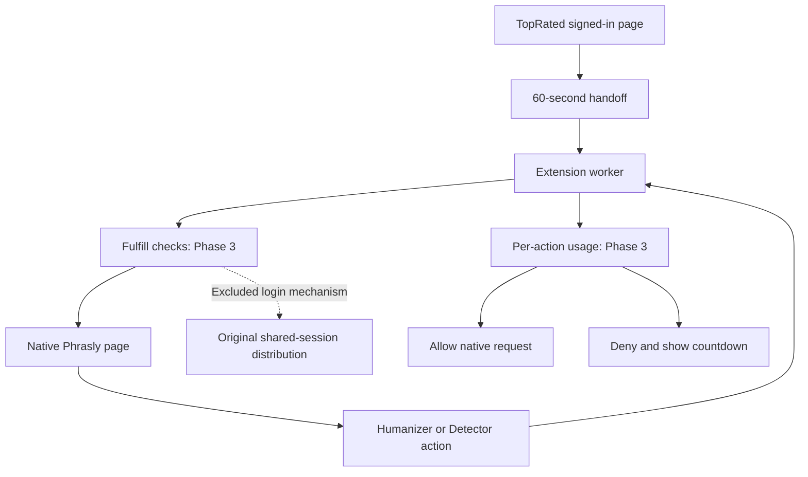

# Phase 2: recovered AWS extension flow

The implementation target is the extension-based native Phrasly workflow recovered from AWS. This branch does not deploy or enable a tool.

**Status: first-party protocol and extension components implemented and tested; full automatic provider-login parity is blocked by the original no-session-transfer constraint.** Do not describe this as an end-to-end working Phrasly login.

## Actual recovered behavior

The original source, rather than filenames or another integration's documentation, defines this flow:

1. The platform's authenticated page requests `ext-handoff.php` for a tool and feature.
2. It passes `trst_access`, `payload` and `signature` to the extension.
3. The extension calls `ext-fulfill.php`. That endpoint rechecks account status, subscription, feature grant and remaining allowance. Opening the tool does not increment usage.
4. The original fulfillment assigns a shared provider account and returns its cookies. The original worker writes those cookies into the browser, opens Phrasly, hides account controls and blocks selected account-management paths.
5. A separate four-hour record token identifies per-action usage. The MAIN-world script watches Phrasly's native Humanizer/Detector requests and relays `trst_check_usage` through the content script and service worker.
6. `ext-check-usage.php` rechecks access and increments the feature's counter before allowing that native request. Reset is midnight Africa/Lagos. This is attempt accounting, not proof that provider processing completed.

Tinyproxy is not in this active extension path. The browser contacts Phrasly directly. The recovered PHP proxy and relay are separate paths and are not being substituted for the extension.

## Source correspondence

[The source map](phase2-aws-source-map.json) identifies nine recovered original files and their hashes. All nine match the pinned recovery manifest after removing the single final LF added when the local inspection copy was written. Original session-bearing data is not included in the map or this branch.

| Recovered component | This branch | State |
| --- | --- | --- |
| 60-second handoff, base64url JSON and HMAC-SHA256 hex | `src/lib/phrasly-extension/protocol.server.ts` | Ported, including field order and expiry boundary |
| Separate 14,400-second record token | Same module | Ported; no provider credential in this token |
| Per-feature quota boundary and WAT day/reset | Same module | Ported as pure helpers; database atomicity belongs to Phase 3 |
| External `trst_access` message and fulfillment | `extensions/phrasly-oneclick/background.js` | Ported with strict first-party sender validation |
| Session-backed tab tracking | Same worker | Ported; survives worker restart; serialized writes prevent lost concurrent records |
| Native action hooks, MAIN → isolated → worker relay | `interceptor.js`, `content.js` | Ported using the two recovered exact request paths; no text or provider response is sent to TopRated |
| Per-action `record_token` and `feature` fields | Worker | Preserved; adds `action_id` for Phase 3 duplicate protection |
| Countdown on quota exhaustion | `limit-reached.html`, `limit-reached.js` | Ported to the .com dashboard |
| Native provider account authentication | Not implemented | Original shared-cookie distribution excluded |
| Popup `trst_whoami` through privileged PHP session header | Not implemented | TopRated uses Supabase; first-party account UI integration is Phase 4 |

## Authentication boundary



The diagram is the target first-party integration contract. The future server handlers and native provider authentication are not represented as deployed functionality.

The source's automatic provider login comes from assigning and injecting a shared provider session. It does not come from the HMAC handoff, the usage token, Tinyproxy, or simply copying the extension files.

Your original migration instruction excludes active provider-session transfer and mechanisms that bypass third-party access restrictions. Accordingly, the port has no cookie permission, no cookie-reading/writing code, no account-menu hiding and no account-navigation blocking. The worker rejects an original cookie-bearing fulfillment response. It can open a native Phrasly page without authenticating the user; it does not claim to reproduce the excluded automatic login.

This is the precise remaining parity gap. It is not a missing source-file or SSH-access problem. No replacement processing service is part of this approach.

## Required first-party backend wiring: Phase 3

The `.php` paths below are preserved as HTTP contracts. They need actual handlers on TopRated's Node application; PHP file execution is not assumed.

| Contract | Required server behavior |
| --- | --- |
| `ext-handoff.php` | Verify the existing Supabase session, fresh account/access state and feature grant; issue a fresh short-lived capability |
| `ext-fulfill.php` | POST redemption; constant-time signature/expiry checks; one-use redemption in a transaction; recheck grants/allowance; create a limited first-party record capability |
| `ext-check-usage.php` | POST; verify record capability and exact extension origin, fresh account/order/grant state and allowed feature; atomically accept one action or deny it |
| `ext-whoami.php` | First-party authenticated account/tool state; no raw PHPSESSID forwarding or privileged session-header shortcut |

Use `context.userId` from verified TopRated authentication, `profiles.account_status`, active unexpired `tool_orders` / `tool_access_grants`, and separately assigned per-feature limits. Do not trust an unsigned user ID supplied by a browser. UUIDs replace AWS integer user IDs without copying customer records.

The existing TopRated `tool_usage` records launches; it is not the recovered per-feature daily counter schema. Use additive extension-specific tables for grants, handoff/redemption state, action IDs and daily counts. The counter must be guarded atomically, with a unique user/tool/feature/WAT-day key and action deduplication. Do not change financial tables or payment records.

The recovered token format alone does not prevent replay. Phase 3 must add transaction-backed single-use handoffs, safe issuance uniqueness and record revocation. The current crypto helper is not a complete authorization endpoint.

## Explicit safety changes

- Backend redemption uses POST so signed capabilities do not enter URL logs.
- External callers are restricted to the configured TopRated origin. Usage calls require a tracked top-level native tab and known feature.
- The original four-second timeout allowed requests to proceed. The port denies on timeout instead.
- Native action matching is origin/exact-path/POST-specific rather than a substring match on arbitrary URLs.
- A disabled extension leaves normal Phrasly requests untouched. Enabled quota checks apply only to TopRated-managed tabs; independent use of the user's provider account is not restricted or metered by TopRated.
- Provider authentication/account controls and cookies are not modified. Only first-party allowance metadata is relayed.

Client-side interception cannot stop someone from using their own provider account outside the extension, and page-origin messages are not a provider authorization boundary. The provider remains responsible for its own login, subscription and quota enforcement. These tests do not establish otherwise.

## Build and verify

The source extension is disabled by default. A real browser install and full website wiring have not happened.

```sh
node --experimental-strip-types --test tests/phrasly-extension-protocol.test.ts tests/phrasly-extension-worker.test.cjs
python3 tests/phrasly-extension-build.test.py
python3 scripts/phrasly/build-native-extension.py --origin https://YOUR_STAGING_DOMAIN --out /ABSOLUTE/NEW/DIRECTORY
```

The builder accepts a plain HTTPS origin, restricts first-party host access and refuses to overwrite an existing directory. `--enabled` is only for later staging after the first-party handlers exist. The actual new extension ID must be configured in the backend; the AWS manifest key/ID is not reused.

Component tests cover token vectors, tampering/expiry/purpose separation, WAT and quota boundaries, worker lifecycle/concurrency, complete synthetic page-to-worker action relay, deny/timeout behavior and packaging restrictions. Fixtures do not log in to Phrasly or process real text. CI also typechecks the port and compiles the unchanged application with dummy configuration.

Production remains intact. The retired proxy's HTTP 410 rules stay in place. Live provider authentication, real browser operation and full end-to-end processing remain unverified.
