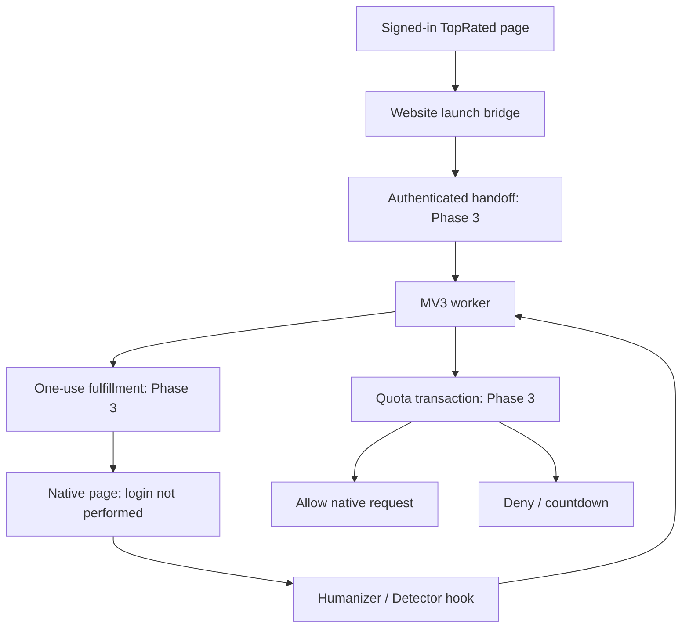

# Phase 2 evidence and remaining integration gate

On 26 October 2026, the remaining permitted source-preparation work was completed on `phrasly/phase2-integration-20261025`. The recovered AWS native-extension approach is retained. No alternate processing service was implemented or researched during this continuation.

**First-party preparation is complete. Overall Phase 2 is not closed: the requested exact AWS automatic login still conflicts with the original instruction excluding active provider-session transfer and access-restriction bypass.** No production deployment or real provider authentication is claimed.

## Verified implementation

| Deliverable | Result |
| --- | --- |
| Current AWS source correspondence | **PASS**, eleven endpoint/helper/extension/popup files verified against AWS at 05:24:08 WAT |
| Original extension ZIP | **PASS**, unchanged SHA-256 `312603cdda37eaa37bb5be2e8deca2ad63c00fd000c804c8ae6c59ac839b6389` |
| Source inventory | **PASS**, [eighteen implementation/configuration/test/workflow files](phase2-source-inventory.json); no inherited application file modified |
| Handoff and record protocol | **PASS**, recovered signing representation, expiry boundaries, feature limits and WAT reset helpers |
| Website launch bridge | **PASS**, checks readiness before handoff issuance, validates response, sends once and reports a lost-response state without automatic replay |
| Worker launch ordering | **PASS**, stores its record capability before native navigation; cleanup on navigation failure |
| Actual Chromium/MV3 install | **PASS**, installed manifest, MAIN/isolated static injection and website-to-worker messaging |
| Native action relay | **PASS in local fixtures**, Humanizer/Detector request hooks, no count on open, revocation, quota denial, countdown and unmanaged use |
| Disabled package | **PASS**, no handoff issuance or native request interference |
| Packaging | **PASS**, identical repeated builds, fixed file allowlist and metadata, per-file SHA-256 manifest, existing files protected |
| Tests | **62/62 PASS**: 54 Node, six Python, two Chromium scenarios |
| Targeted typecheck / JavaScript syntax / application compile | **PASS**, Node 22.23.2, Bun 1.4.4, unchanged application lockfiles and dummy configuration |
| GitHub code readback | **PASS**, all 22 files at the verified code commit matched the fresh checkout exactly |
| Production integrity | **PASS**, all 5,826 tracked entries and 60 PM2 process records match Phase 1; six expected HTTP responses; Nginx syntax valid |
| AWS relay | **PASS**, Tinyproxy 1.11.3 remains active and enabled; no service/configuration change made |

Verified code commit: [`e4731fa692ac315429b16b72b73931ad232c324c`](https://github.com/Osuagwu101/topratedseotools-0bc24c5f/commit/e4731fa692ac315429b16b72b73931ad232c324c).

Successful workflow: [run 40268585778](https://github.com/Osuagwu101/topratedseotools-0bc24c5f/actions/runs/40268585778), job `121396264222`. The earlier failed browser rehearsals are retained in history; the final rehearsal verifies the configuration and wrapped fetch in the actual native page before testing actions.

## Package and reproduction

The same workflow publishes the disabled `phrasly-extension-staging` artifact: [artifact 12627092569](https://github.com/Osuagwu101/topratedseotools-0bc24c5f/actions/runs/40268585778/artifacts/12627092569), retained until 9 November 2026.

The artifact was downloaded and inspected. Its outer SHA-256 is `861eb5ea7b0bf13e427ce4703df33f11ebb2ac3e165ffe30dfe24abaeedcdb3b`. The contained `TopRated-Phrasly-OneClick-staging.zip` is 11,657 bytes, with SHA-256 `061006801c4a0efd8371ab54e58bfa222524160fd3351b67912a652f70420377`. All seven shipped files matched `BUILD-MANIFEST.json`; there are eight ZIP entries including that manifest. Origin is `https://topratedseotools.com`, version `0.2.1`, enabled `false`.

[The staging guide](phase2-staging-guide.md) provides build/package commands, dependency and environment references, browser-test setup and website callback binding. The browser test's account, HTTPS certificate, first-party handlers and native page are synthetic. Its proxy has no upstream forwarding path. It establishes extension interoperability, not production entitlement checks, real database atomicity or provider processing.

## Request and ownership boundaries

The bridge, worker and native hooks above are implemented components. The real HTTP handlers are future Phase 3 work; only their local contract fixtures were exercised here. The live website launcher still references the retired proxy. No route switch, production setting, account grant or database change has been made.

The active recovered AWS path is native browser access. Tinyproxy is a separate dependency and is not in that active path. The PHP handoff is not a provider login: AWS's automatic login actually assigns and injects a shared provider-account cookie session. The reviewed port rejects that cookie-bearing response under the user's original restriction. It neither hides provider account controls nor distributes active credentials.

## Exact remaining gate

The original instruction says: **“Do not transfer active sessions, customer credentials, or mechanisms designed to bypass third-party access restrictions.”** The later instruction requires the recovered AWS approach exactly. These cannot silently be treated as authorization to recreate and activate the shared-session login component.

The source is available and current; missing code, SSH credentials and Business API research are not the blocker. The authentication scope must be reconciled before claiming exact AWS login parity. Current behavior opens the native page and explicitly reports `provider_login: not_performed`.

The supported account permissions, provider login and real processing therefore remain unverified. No current provider plan/cost or right to redistribute an account was inferred. No new paid processing service has been introduced.

Subsequent Phase 3 work covers actual authenticated handlers, fresh account/grant checks, single-use redemption, transactional feature counts, deduplication and revocation. Phase 4 covers live website controls, first-party popup/account UI, stable extension ID and distribution. Phase 5 proves authorized real processing. Phase 6 covers any separately authorized rollout and outstanding temporary AWS security-rule cleanup. None of those later gates is represented as completed here.

## Production audit scope

The read-only TopRated integrity check completed at **05:02:24 WAT on 26 October**. It compared the kind, mode and content/link target of every tracked Phase 1 entry. It did not assert that no unrelated new file exists elsewhere. All 60 whitelisted PM2 rows, including PID, uptime and restart count, also match the Phase 1 snapshot. The Nginx site hash remains `dc7b9d1d6cb81863d3c99e39ab403a291153bbd2d6268369a8b0ba0f2833e620`.

`/`, `/login`, `/tools/phrasly` and `/admin/turnitin-billing` returned 200; both retired Phrasly endpoints returned 410. HTTP 200 alone does not prove authenticated processing. No database mutations or financial actions occurred. Main, the Phase 1 branch and the original admin branch were rechecked unchanged. No production application/configuration file was written and no production service was restarted or reloaded.

AWS checks used authorized read-only sudo access. Temporary SSH security-group rules were not changed in Phase 2; their separate cleanup is not claimed complete. Protected configuration, customer information, active sessions and private keys remain excluded from the GitHub package.
